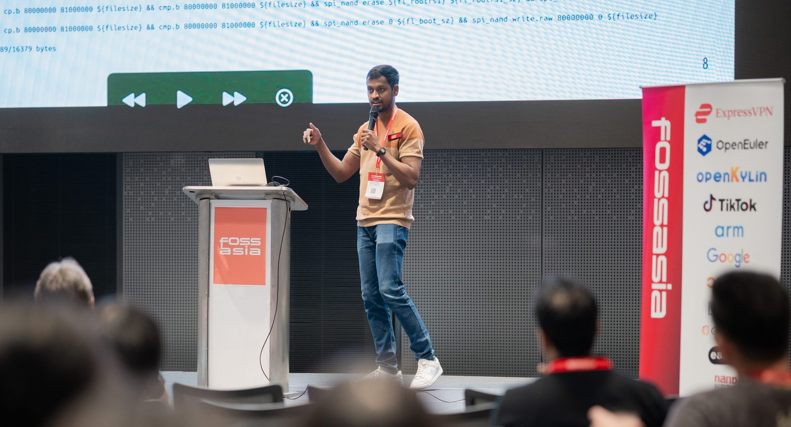

---
# the default layout is 'page'
title: "# whoami"
icon: fas fa-info-circle
order: 3
---

I'm a software engineer at [Pixxel](https://www.pixxel.space/), where I work on building satellites, specifically the flight computers that run them. I'm also a Linux kernel contributor, which has taken me down more rabbit holes than I can count.

This blog is where I write about the things I dig into, like embedded systems, reverse engineering, radio, debugging deep in the stack, and occasionally something completely unrelated. I also love data analysis. I enjoy collecting real-world data, plotting it and finding the stories hidden in it, as in my [TPMS series](/posts/tpms-intro/) and [Newton's first law and the Barometer](/posts/barometer-and-inertia/). If you've ever wondered how your ISP router actually works, why that kernel driver is misbehaving at 3am, or what your car's tyres are saying about you, you'll feel right at home here.

Outside of work, I speak at open source conferences, most recently at Open Source Summit India by the Linux Foundation. You can find my talks and slides on the [Conference Talks](/talks/) page.

I'm also an amateur astronomer who can name every constellation in the sky, a cricket fan who watches every ball of every televised match, and someone who finds gardening surprisingly therapeutic. I enjoy photography too, and you can find some of my shots [here](/photography/).

If you want to get in touch, the [Contact](/contact/) page is the best way to reach me.
